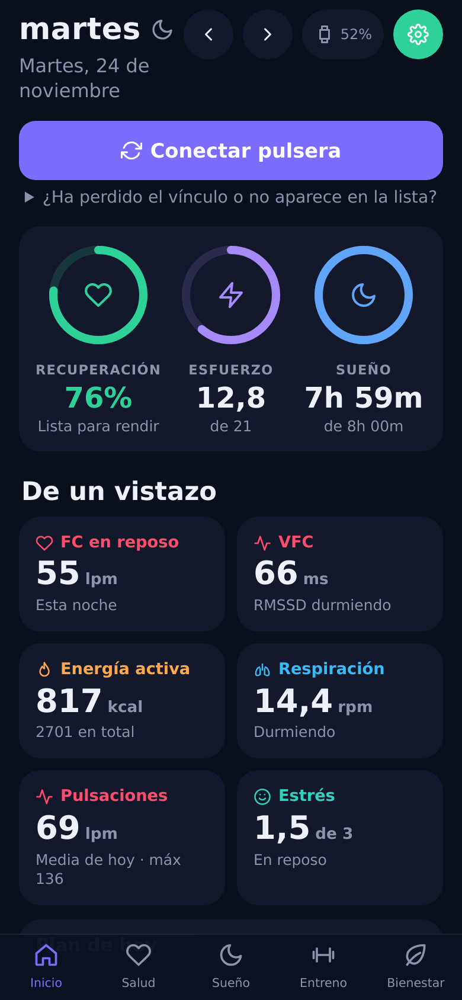
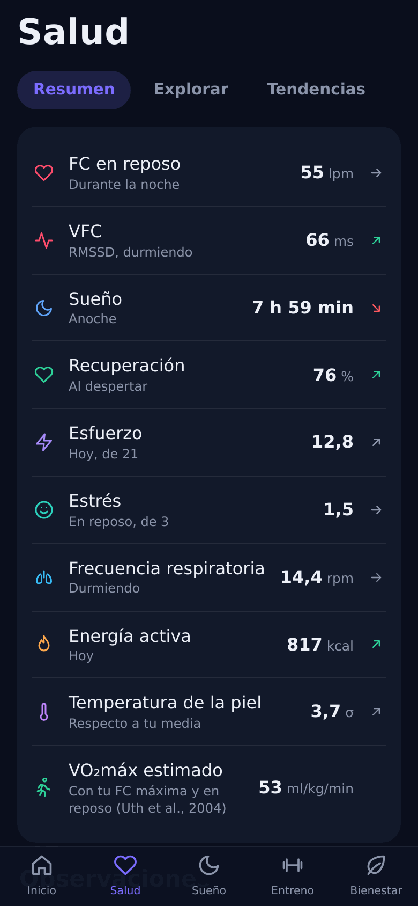
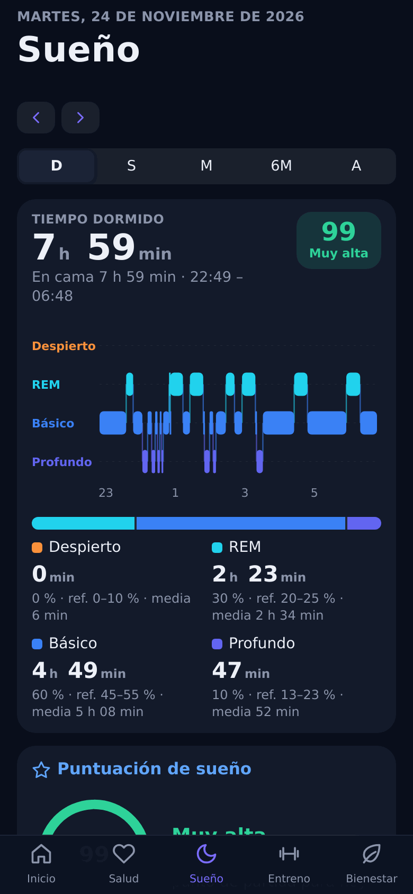
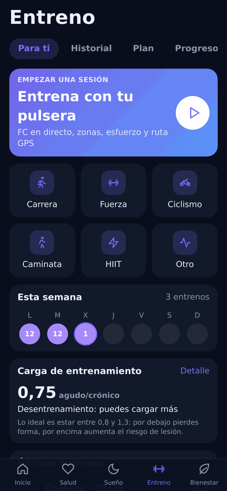
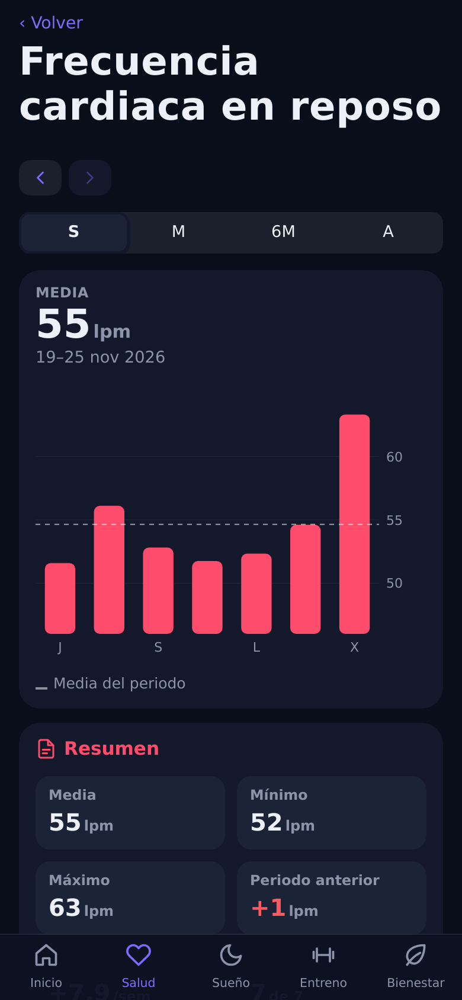

# Pulso — tu WHOOP 4.0 sin suscripción

Pulso es una app **en español**, **autoalojada** y **privada** para usar una pulsera **WHOOP 4.0** sin pagar suscripción.
El iPhone descarga los datos de la pulsera por Bluetooth (con el navegador **Bluefy**), los guarda en **tu propio
servidor** y allí se calculan sueño, recuperación, esfuerzo, VFC, estrés y todo lo demás. Nada sale de tu red.

<p align="center">
  
  
  
  
  
</p>

> Capturas con datos de demostración. En el ordenador, la misma web muestra todo con más detalle:
> [vista de escritorio](docs/capturas/escritorio-sueno.png).

## Qué hace

**Inicio** — saludo, los tres anillos del día (recuperación, esfuerzo y sueño, con aviso de calibración los primeros
días), «De un vistazo» (FC en reposo, VFC, energía, respiración, pulsaciones, estrés), «Plan de hoy» (esfuerzo objetivo,
entreno del plan, a qué hora acostarte, despertador) y observaciones.

**Salud** — cada dato con su tendencia frente a tu media de 30 días, VO₂máx estimado, observaciones, siestas, explorador
por categorías, tendencias de 30 días frente a los 30 anteriores y constantes nocturnas frente a tu rango habitual.
Cada dato tiene su página con periodos **D · S · M · 6M · A**, gráfica táctil, **tu rango normal** (más bajo, típico,
más alto), datos para curiosos y una explicación.

**Sueño** — hipnograma por fases (despierto, REM, básico, profundo), noches como barras flotantes por semanas y meses,
puntuación con desglose, la noche en detalle (FC, VFC, respiración, movimiento y temperatura sincronizados), datos de
la noche, **a qué hora te acuestas y te levantas cuando mejor te recuperas**, índice de regularidad (SRI), jet lag
social, cronotipo, deuda de sueño y hora recomendada para acostarte.

**Entreno** — sesiones en directo con FC, zonas, esfuerzo y calorías; al aire libre, **ruta GPS** dibujada con tus
propios puntos (sin mapas de terceros), distancia, ritmo y **exportación GPX**. Entrenos detectados por la pulsera,
importación de **Strong** y **Strava** (y subida a Strava con la curva de FC), planes periodizados que se adaptan a tu
recuperación, progreso de 1RM y carga de entrenamiento (agudo/crónico).

**Bienestar** — estrés del día, respiración guiada con biofeedback de VFC, medición de VFC matinal de 2 minutos,
diario de hábitos con su impacto real, medidas corporales y despertador en la pulsera (también semanal).

**Y además** — informe semanal y avisos por **Telegram**, envío de sueño y frecuencia cardiaca a la app **Salud** del
iPhone con un Atajo, batería con estimación de autonomía, copia en crudo de cada bloque descargado (se puede volver a
leer si cambia el formato), modo demostración, tema oscuro o claro y exportación de todos tus datos.

## Cómo funciona

```
WHOOP 4.0 ──Bluetooth──▶ iPhone (Bluefy, web de Pulso) ──HTTPS por Tailscale──▶ tu servidor (Docker)
                         descarga el historial,                           guarda las muestras,
                         lo guarda primero en el móvil                    analiza cada día (motor en Swift),
                         y solo entonces la pulsera lo borra             informes, Telegram, Strava…
```

- **Web sin compilación** (Preact + htm, gráficas SVG propias) servida por **FastAPI**; datos en SQLite y en archivos
  binarios por día (una muestra por segundo).
- **Motor de análisis en Swift** (`Packages/WhoopKit`): protocolo de la pulsera, épocas, VFC, fases de sueño,
  respiración por arritmia sinusal, esfuerzo (TRIMP), calorías, recuperación, estrés y carga.
- **Privacidad**: el puerto solo escucha en `127.0.0.1` y se publica dentro de tu tailnet con `tailscale serve`
  (nunca con *funnel*). Las claves de Telegram, Strava o IA se introducen desde la web y se guardan en tu servidor.

## Instalación

Necesitas un servidor Linux con **Docker** y **Tailscale**, y en el iPhone **Tailscale** y el navegador **Bluefy**.

```bash
git clone https://github.com/glezpedro/pulsoAbierto.git pulso
cd pulso
sudo bash server/install.sh
```

El script construye la imagen (la primera vez tarda unos minutos porque compila el motor), la deja como stack de
Dockge en `/opt/stacks/pulso` y la publica en tu tailnet. Edita `PULSO_PUBLIC_URL` en `/opt/stacks/pulso/compose.yaml`
con tu dirección de Tailscale. Todos los detalles (primer uso, Telegram, Strava, Strong, Atajos de iOS, copias de
seguridad, monitorización): **[`server/README.md`](server/README.md)**.

Para actualizar: `git pull && sudo bash server/install.sh`. Los datos no se tocan.

## Importante

- **No vuelvas a conectar la pulsera a la app oficial de WHOOP**: puede instalarle un firmware nuevo. En la WHOOP
  5.0/MG algunos firmwares ya no entregan los datos a apps de terceros.
- Pulso usa métodos científicos publicados; sus números se parecerán a los de WHOOP pero no serán idénticos. Las fases
  de sueño, la SpO₂ y la temperatura son **estimaciones**. **No es un dispositivo médico.**
- La pulsera solo sincroniza mientras la web está abierta en el iPhone (una web no puede usar Bluetooth en segundo
  plano). Ábrela una vez al día y pulsa «Sincronizar».
- Pulso no está afiliado a WHOOP, Inc. Usa el protocolo Bluetooth documentado por la comunidad para interoperar con tu
  propio dispositivo.

## Desarrollo

```bash
cd Packages/WhoopKit && swift test                              # núcleo Swift
node --test server/tests/protocol.test.mjs                      # protocolo de la pulsera en JS (tramas reales)
python3 -m unittest discover -s server/tests -p 'test_*.py'      # servidor
PULSO_DATA=/tmp/pulso PULSO_ENGINE=$PWD/Packages/WhoopKit/.build/release/pulso-engine \
  uvicorn app.main:app --app-dir server --port 8791             # servidor local (Ajustes › Generar datos demo)
```

- Investigación del dispositivo y del protocolo: [`docs/INVESTIGACION_WHOOP4.md`](docs/INVESTIGACION_WHOOP4.md)
- Historial de cambios: [`docs/CAMBIOS.md`](docs/CAMBIOS.md)
- App nativa de iPhone (experimental): [`docs/APP_IOS.md`](docs/APP_IOS.md)

## Agradecimientos

El protocolo de la WHOOP 4.0 se conoce gracias al trabajo abierto de la comunidad, entre otros
[OpenStrap](https://github.com/OpenStrap), [whoop4-ble](https://github.com/AStrasler/whoop4-ble),
[noop](https://github.com/ryanbr/noop) y [whoop-rs](https://github.com/eugenehp/whoop-rs). Pulso no reutiliza su código.

## Licencia

[MIT](LICENSE).
